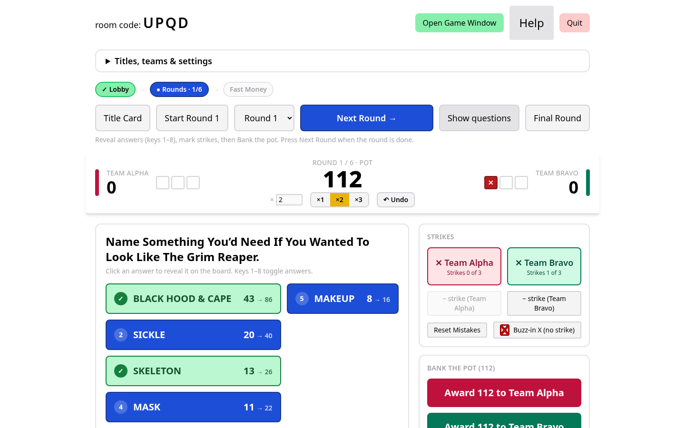
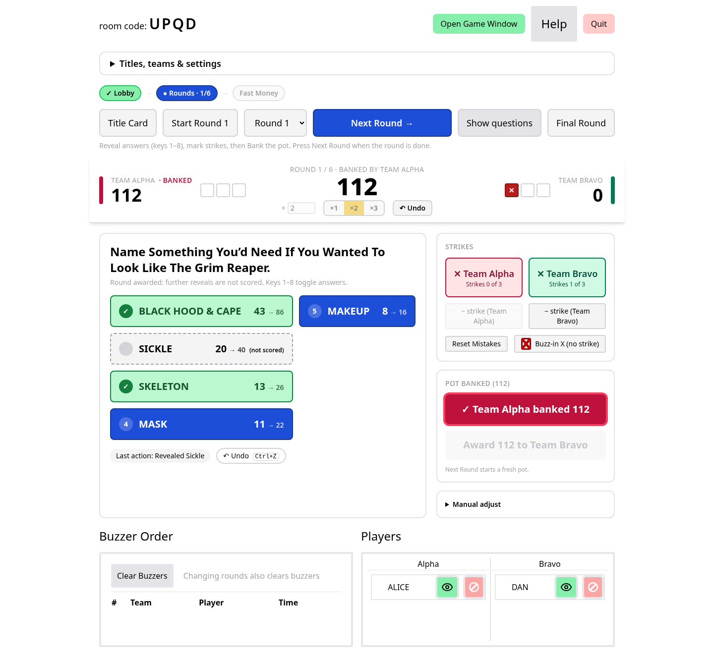
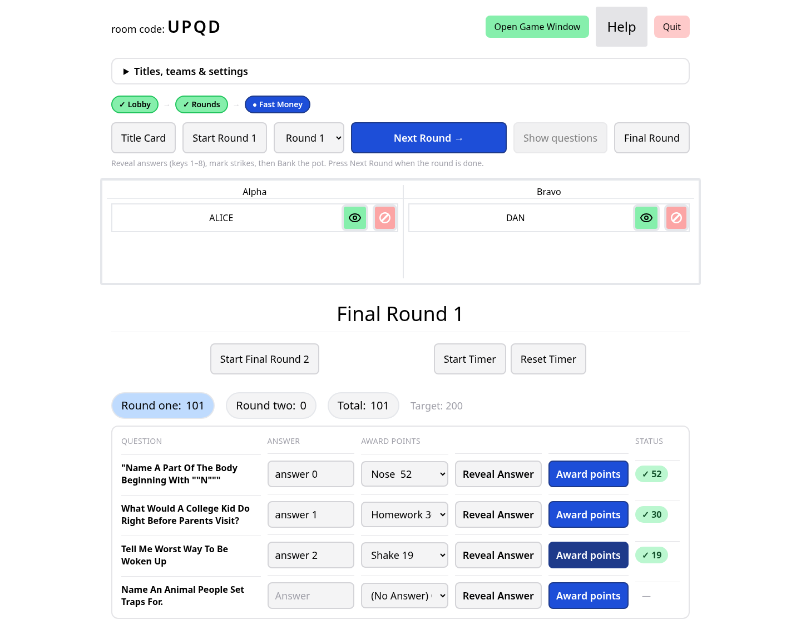
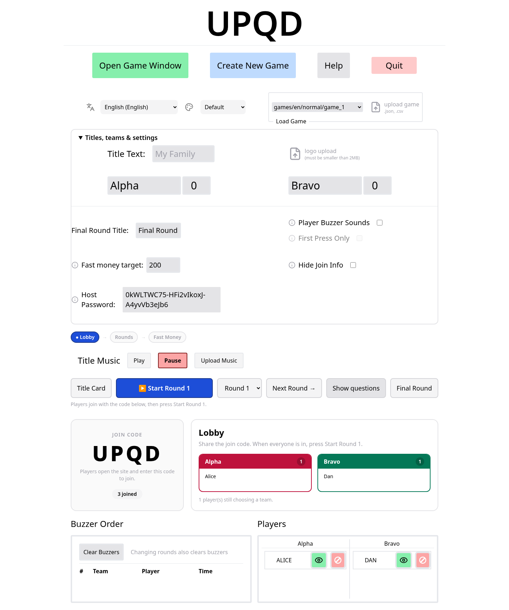

# Friendly Feud — Game Guide

A complete guide to running and playing Friendly Feud, the open‑source family‑feud‑style
party game. This guide describes exactly what **this build** does; where the game leaves a
decision to you (the host), it is called out as a **House rule** suggestion.

> **TL;DR for the host:** Host a room → open the game window on the TV → players join on
> their phones with the room code → start Round 1 → reveal answers, mark strikes, bank the
> pot → repeat → Fast Money → read the final scores.

---

## 1. Quick start for the host

1. **Create a room.** Open the site and click **Host**. You get a 4‑letter **room code**
   and become the host of that room. A random **host password** is generated for you — you
   never type it; it travels automatically with everything the host console sends. It is
   what proves to the server that control messages really come from you.
2. **Load a game.** In **Titles, teams & settings**, pick a built‑in game from the
   dropdown, or load your own `.json`/`.csv` file (see [Creating your own games](#8-creating-your-own-games)).
   You can also set team names, a title, a logo, and the theme here.
3. **Open the game window on the TV/projector.** Click **Open Game Window**. This opens the
   big **board** view (`/game`) in a new tab — put it on the TV or projector. It mirrors the
   room live. Open it on the same device (second screen) or a second device (see
   [Second device / separate screen](#102-host-the-board-on-a-separate-device)).
4. **Players join on their phones.** Each player opens the site, enters the **room code**,
   types a name, taps **Join**, then **picks a team** (Alpha/Bravo or your custom names) and
   presses **Play** to arm their buzzer.
5. **Spectators / extra screens.** Anyone who joins can instead press **Open Game Window**
   (to show the board on another device) or **Host Buzzers** (a shared two‑button buzzer
   screen) rather than picking a team. Choosing “Open Game Window” registers them as a
   spectator (they take no buzzer slot).
6. **Start the game.** Press **Start Round 1**. You’re now scoring.

---

## 2. The host console at a glance

The console has three phases, shown in the **phase bar** at the top
(**Lobby → Rounds N/N → Fast Money**):

- **Lobby** — before the game: big join code, per‑team roster, and the primary
  **Start Round 1** button.
- **Rounds** — the main game: sticky score bar, the answer grid, strikes, and “bank the pot”.
- **Fast Money** — the final round: one row per question with reveal/award controls.

There is always **one obvious primary (blue) button** for the current phase; the other
controls are secondary. A one‑line hint under the buttons tells you what to do next.

See the full [Host console reference](#7-host-console-reference) for every button.



---

## 3. Main rounds

### 3.1 The face‑off (buzzers)
When a round starts, buzzers are cleared. Players buzz from their phones (or a host presses
the shared **Host Buzzers** screen). The board pops up a banner naming **who buzzed first**,
and the host console marks that team **“buzzed first” / in control**.

- The “in control” marker is **informational** — the game does **not** enforce turn order,
  lock anyone out, or make the other team wait. You run the face‑off by voice and decide
  who answers.
- **House rule suggestion:** play it like classic Feud — the two fastest players face off on
  the top answer; whoever reveals the higher answer wins control and chooses to **play** or
  **pass**. The app won’t stop you running it however you like.

### 3.2 Revealing answers
Click an answer in the **answer grid** (or press keys **1–8**) to reveal it on the board.
Clicking again (or pressing the key again) hides it. Revealed answers add to the **round
pot**; the board shows each card’s value as `points × multiplier`.

By default the **question text is hidden** on the TV board. Use **Show questions /
Hide questions** to toggle it.

### 3.3 Strikes, 3 strikes, and the steal
Give a wrong‑answer **strike** with **✕ Team** in the Strikes panel. Each team has **three
strike slots**; strikes are capped at 3.

- **Buzz‑in X vs a real strike.** The **Buzz‑in X (no strike)** button flashes the big ✕ on
  the board (for a missed buzz‑in or a wrong face‑off answer) **without** adding to a team’s
  strike count. The team **✕** buttons add a real strike.
- Fix mistakes with **− strike (Team)** per team, or **Reset Mistakes** for both.
- **The steal.** When a team reaches **3 strikes**, a yellow hint appears: the *other* team
  can steal the pot. The app only **hints** — it does **not** auto‑award or force anything.
  You decide and press the award button for whichever team wins the pot.
- **House rule suggestion:** on a steal, the opposing team gives **one** answer; if it’s on
  the board they **steal the whole pot**, otherwise the controlling team keeps it.

### 3.4 How the round pot is calculated
The pot is derived live from the board — it is **not** a running figure you add to by hand:

```
pot = (sum of the points of every revealed answer) × round multiplier
```

- The **multiplier** makes **Double** (×2) and **Triple** (×3) rounds. Set it per round in
  the game file, or change it live with the **×1 / ×2 / ×3** buttons (or the `×` number box)
  in the score bar.
- A blank or invalid multiplier is treated as **×1** (never 0 or “NaN”).
- Hiding a revealed answer removes its value from the pot again.

### 3.5 Banking / awarding the pot
Press **Award N to [team]** (the team‑coloured buttons under **Bank the pot**) to give the
current pot to a team. That adds the pot to the team’s score and **locks the round**:

- The awarded team’s button shows **“✓ [team] banked N”**; both award buttons and the
  multiplier controls are then disabled for that round.
- The score bar shows **“Banked by [team]”** and the team panel shows a **Banked** tag.



### 3.6 Answers revealed after banking (not scored)
Once a round is awarded, the pot is **locked to the amount that was banked**. If you reveal
any remaining answers afterwards (to show the audience what was on the board), they are
marked **“(not scored)”**, shown dimmed on the TV, and **do not change** anyone’s score.

### 3.7 Fixing mistakes: Undo and Manual adjust
- **Undo** (score‑bar **↶ Undo** button, or **Ctrl/Cmd+Z**) steps back through your scoring
  actions — reveals, strikes, awards, multiplier changes, manual adjustments — up to 50
  steps. Undo only touches scoring state; it won’t remove players or change settings.
- **Manual adjust** (collapsible panel) adds or subtracts a fixed number of points to a
  team, for corrections the normal flow can’t express. A team’s total never goes below 0.

### 3.8 Worked scoring example
Round answers: **Black Hood & Cape 43, Sickle 20, Skeleton 13, Mask 11, Makeup 8.**
You set the round to **×2 (Double)**.

1. Reveal **Black Hood & Cape (43)** → pot = `43 × 2 = 86`.
2. Reveal **Skeleton (13)** → pot = `(43 + 13) × 2 = 112`.
3. Alpha gives a 3rd wrong answer → strike; Bravo steals with a correct answer.
4. Press **Award 112 to Bravo** → Bravo **+112**, round locks, score bar shows
   “Banked by Bravo”.
5. You reveal **Makeup (8)** to show the board → it appears **(not scored)**; the pot stays
   **112** and no score changes.

---

## 4. Fast Money (the final round)

Press **Fast Money** to switch the board to the final round. Fast Money is played by **two
contestants in turn** against the same set of questions; the goal is a combined score that
reaches the **win target**.



### 4.1 How it’s played
The host runs each contestant through the questions, one row per question in the console:

1. Type what the contestant said in the **Answer** box.
2. Pick the matching board answer (and its points) from the **Award points** dropdown — or
   leave it on **(No Answer) 0**.
3. Press **Reveal Answer** to show their answer on the board.
4. Press **Award points** to score it: the board shows the points and they’re added to the
   total. If the selection was **(No Answer)**, it plays the “try‑again” sound and shows a
   **✗ 0** — it does **not** flash a strike ✕.

**Two halves.** The first contestant plays **Fast Money 1**; press **Start Final Round 2**
for the second contestant. The second half normally **hides the first contestant’s answers**
until you choose to reveal them (**Reveal First Round Answers**), and shows you the partner’s
answer per question so you can judge duplicates.

### 4.2 Timers
Each half has its own countdown (the game file’s `final_round_timers`, default **20s** and
**25s**). Use **Start Timer**, **Stop Timer**, and **Reset Timer**. The circular timer on the
board counts down; when it hits zero the host console is notified.

### 4.3 Duplicate answers
In the second half, if a contestant repeats an answer the first contestant already gave, press
**Already Answered** next to that question. It plays the duplicate buzzer so the contestant
knows to give a different answer. Judging a duplicate is the host’s call.

### 4.4 The total and the win target
The **Total** is the sum of the points from **both** halves. The **Target** defaults to
**200** and is configurable per game in **Titles, teams & settings → Fast money target**
(stored as `final_round_win_threshold`). When the total **reaches or exceeds** the target, the
board shows **WIN** with a confetti celebration.

- **House rule suggestion:** classic Fast Money uses 5 questions and a target of 200 across
  two players. You can set any target and any number of questions in the game file.

---

## 5. Winning and the end of the game

- **Main game:** the app does **not** declare a main‑game winner. It keeps each team’s total
  on the board and in the score bar; **the host reads the scores** to decide who goes to Fast
  Money or who wins. **House rule:** the higher score after your agreed number of rounds wins,
  or the leading team plays Fast Money.
- **Fast Money:** reaching the **win target** triggers the on‑screen **WIN** celebration.
  That’s the only automatic “win” the game shows.
- To wrap up, you can show the **Title Card** again, or press **Quit** to close the room.

---

## 6. Keyboard shortcuts

Host console (ignored while typing in a field, on the title screen, and during Fast Money):

| Keys | Action |
|------|--------|
| **1–8** | Reveal / hide the matching answer in the current round |
| **Ctrl/Cmd + Z** | Undo the last scoring action |

Shared **Host Buzzers** screen:

| Key | Action |
|-----|--------|
| **j** | Buzz for Team 1 (Alpha) |
| **k** | Buzz for Team 2 (Bravo) |

(These let you wire two physical keyboard buttons as buzzers.)

---

## 7. Host console reference

### 7.1 Top bar (always)
- **Room code** — the code players type to join.
- **Open Game Window** — opens the board (`/game`) in a new tab for the TV.
- **Help** — opens this guide.
- **Quit** — tears down the room (only the host can do this).

### 7.2 Flow controls (every phase)
- **Phase bar** — Lobby → Rounds N/N → Fast Money, showing where you are.
- **Title Card** — shows the title screen on the TV; starts a fresh game (asks for a second
  click once a game is in progress).
- **Start Round 1** — puts the board live and begins scoring round 1 (primary button in the
  lobby).
- **Round selector** — jump to a specific round.
- **Next Round →** — clears strikes and moves to the next round; starts a fresh pot (primary
  button during a round). Changing rounds also clears buzzers.
- **Show / Hide questions** — toggles the question text on the TV board (hidden by default).
- **Final Round** — switches to Fast Money.

### 7.3 Lobby



- Big **join code** (and **Join at [URL]** if the instance sets one).
- Per‑team roster with a joined count and empty states.
- **Title Music** play/pause and upload (only on the title screen or while music plays).

### 7.4 Score bar (during a round)
- Each team’s **name, score, and three strike pips**, plus a **banked / buzzed‑first** tag.
- Centre: **round number**, the **Pot** (or “Banked by [team]”), the **×1/×2/×3** presets and
  `×` number box, and **↶ Undo**.

### 7.5 Answer grid (during a round)
- One button per answer; click or press **1–8** to reveal/hide. Shows base value → multiplied
  value, a **(not scored)** tag for post‑award reveals, and the last action with an undo pill.

### 7.6 Strikes & Bank the pot (during a round)
- **✕ Team** — add a strike (max 3). **− strike (Team)** — remove one. **Reset Mistakes** —
  clear both. **Buzz‑in X (no strike)** — flash the ✕ on the board without a strike.
- **Steal hint** — appears at 3 strikes (host decides the award).
- **Award N to [team]** — bank the pot for a team and lock the round.
- **Manual adjust** — add/subtract a set number of points to a team.

### 7.7 Fast Money controls
- **Start Final Round 2 / Back To Final Round 1**, **Reveal / Hide First Round Answers**.
- **Start / Stop / Reset Timer.**
- Per question: contestant **Answer** box, **Award points** dropdown (board answer or
  **(No Answer)**), **Reveal Answer**, **Award points**, a **status** chip, and (in round 2)
  the partner’s answer with an **Already Answered** (duplicate) button.
- **Round one / Round two / Total** tallies and the **Target**.

### 7.8 Players & buzzers (during a round)
- **Buzzer Order** with **Clear Buzzers**.
- **Players** list per team, with per‑player **blindfold** (hide their view) and **remove**
  controls.

---

## 8. Creating your own games

Friendly Feud has a built‑in creator at **/new** (or the **Create New Game** button). You can
also hand‑write a `.json` file or import a `.csv`.

### 8.1 The /new creator
- Add/remove **rounds**; per round set the **question**, a **multiplier** (1 = normal, 2 =
  Double, 3 = Triple), and any number of **Answer + points** pairs.
- Add/remove **Fast Money** questions, each with **Answer + points** pairs, and set the two
  **timer** values (seconds).
- Press **Save** to download a `.json` file; load it back via **Load Game** on the host
  console.

### 8.2 JSON format (essentials)
```json
{
  "settings": { "theme": "default", "final_round_win_threshold": 200 },
  "rounds": [
    {
      "question": "Name something you'd need to look like the Grim Reaper.",
      "multiply": 1,
      "answers": [
        { "ans": "Black Hood & Cape", "pnt": 43 },
        { "ans": "Sickle", "pnt": 20 }
      ]
    }
  ],
  "final_round": [
    {
      "question": "Name a part of the body beginning with N.",
      "answers": [["Nose", 52], ["Neck", 34]]
    }
  ],
  "final_round_timers": [20, 25]
}
```
- Main‑round answers are `{ "ans": string, "pnt": number }`; **Fast Money** answers are
  `["answer text", points]` pairs.
- `multiply` is the round’s Double/Triple multiplier. `final_round_win_threshold` is optional
  (defaults to 200).

### 8.3 CSV format
A spreadsheet export where each line is a round:
```csv
Question, Answer, Points, Answer, Points, Answer, Points
Question, Answer, Points, Answer, Points, Answer, Points
```
On import you choose how many rows are **rounds** vs **Fast Money** questions.

---

## 9. Player guide (short)

1. **Join.** Open the site, enter the **room code**, type your name, tap **Join**.
2. **Pick a team** (Alpha/Bravo or custom names), then press **Play** to arm your buzzer.
3. **Buzz.** On a face‑off, tap the big **BUZZ** button. The board shows who buzzed first.
   Buzzers reset between rounds.
4. **What you see.** Your team, the score, and strikes. If the host “blindfolds” you, your
   view is hidden until they turn it back on.
5. **Not playing?** Instead of a team, choose **Open Game Window** (to show the board on a
   screen) or **Host Buzzers** (a shared two‑button buzzer).

---

## 10. Troubleshooting & FAQ

### 10.1 Reconnecting
Your browser remembers your session. If you drop, reopening the site usually puts you back in
the room automatically. If you see “room not found,” the room was closed or timed out
(inactive rooms are cleaned up) — rejoin with a fresh code.

### 10.2 Host the board on a separate device
Host on your controller device, then on the TV device **Join** with any name and press
**Open Game Window** instead of picking a team. For a shared physical buzzer, pick **Host
Buzzers** and enter the **host password** shown on the admin page; that screen responds to the
**j** and **k** keys.

**Security note.** Only the **host** (the browser that created the room, carrying the host
password) can control a room — reveal answers, score, change settings, or quit. Other
browsers, players, spectators, and people in other rooms **cannot** send control actions, even
if they know the room code. Keep the host tab/session to yourself; don’t share the host
password or the host’s session. (For a public deployment, also set a real `ALLOWED_ORIGINS`
and strong admin secrets — see the deployment notes.)

### 10.3 The game window isn’t updating
- Make sure the game window tab is still open and connected; reload it — it rejoins the room
  from your saved session.
- The board follows the host console; if nothing changes, confirm you’re acting in the
  **host** tab (not a spectator/player tab).
- A stale page can happen behind some dev proxies — a reload fixes it.

---

*This guide reflects the behaviour of the code on the `scoring-ui` branch. Rules the app
doesn’t enforce are marked as House rule suggestions; everything else is what the app
actually does.*
