<div align="center">

# 🎯 Friendly Feud: Redesign

**A rebuilt host console, a real USB buzzer, and a fully Estonian UI for the open-source Family Feud game.**

[](https://m0usetrap.ee)
[](https://github.com/joshzcold/Friendly-Feud)
[](#-languages)
[](Friendly-Feud/LICENSE)


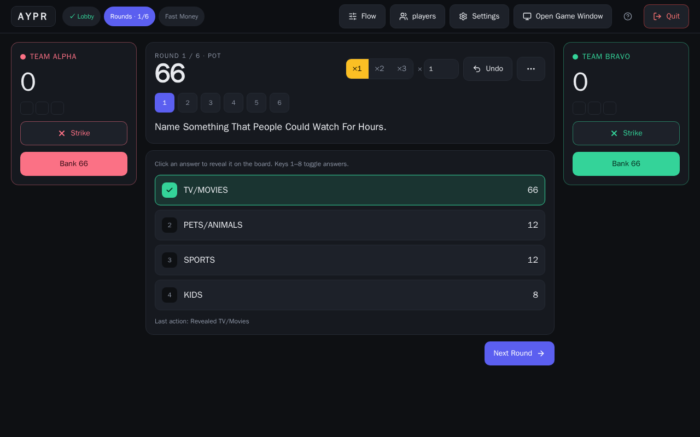

**[▶ Play it live](https://m0usetrap.ee)** · **[Quickstart for hosts](https://m0usetrap.ee/docs/en/quickstart)** · **[Hosting guide](Friendly-Feud/deploy/README.md)**

</div>

---

## ✨ What's new

This is a fork of [joshzcold/Friendly-Feud](https://github.com/joshzcold/Friendly-Feud). The game rules and
the TV board are the original's; most of what you touch as a host has been rebuilt.

| | |
|---|---|
| 🎛️ **New host console** | A dark, dense console built for one hand on the mouse: round stepper, one-click Strike and Bank, ×1/×2/×3 multipliers, **Undo**, and keys `1`-`8` to reveal answers. |
| 🔔 **USB buzzer** | Bind any key (a USB arcade button works as a keyboard) to a physical buzzer. A press starts the buzz, and the host gets a **"Who was first?"** prompt to give it to the right team. |
| 🧭 **Guided tour** | First-time hosts get an interactive walkthrough. It's replayable from the Help menu, and there's a written quickstart. |
| 🇪🇪 **Estonian, properly** | Full Estonian UI and docs, plus Estonian question sets. The game is branded **Lendude Sõda**. |
| 🗂️ **Better setup** | Card-style lobby and settings, question sets grouped into *Classic* and *Themed*, Fast Money rebuilt to match. |
| 📱 **Works on a phone** | The host console and the player pages are responsive. The host can run a game from a phone or tablet. |
| 🔒 **Hardened for the open internet** | Host-only actions are authorised on the server, with per-IP room-creation limits and a global room cap. |
| 🚀 **One-command deploy** | Docker image plus Caddy for automatic HTTPS, with a script for a free-tier Google Cloud VM. |

## 📸 Screenshots

<table>
  <tr>
    <td width="50%">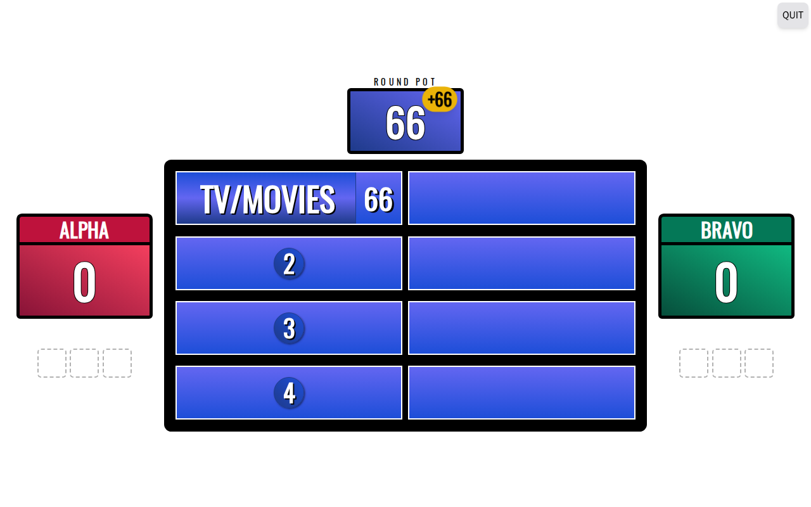<br><sub><b>The TV board</b>: show it on the big screen</sub></td>
    <td width="50%">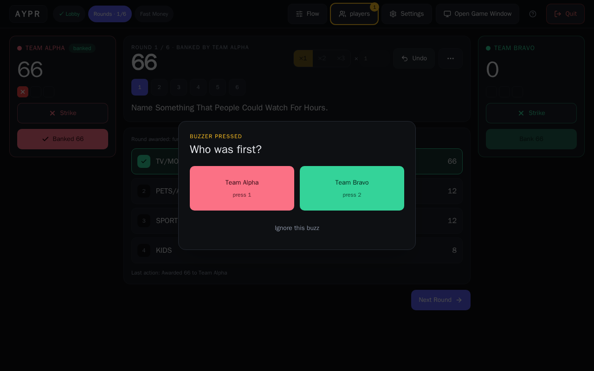<br><sub><b>Who was first?</b> Settles photo-finish buzzes</sub></td>
  </tr>
  <tr>
    <td>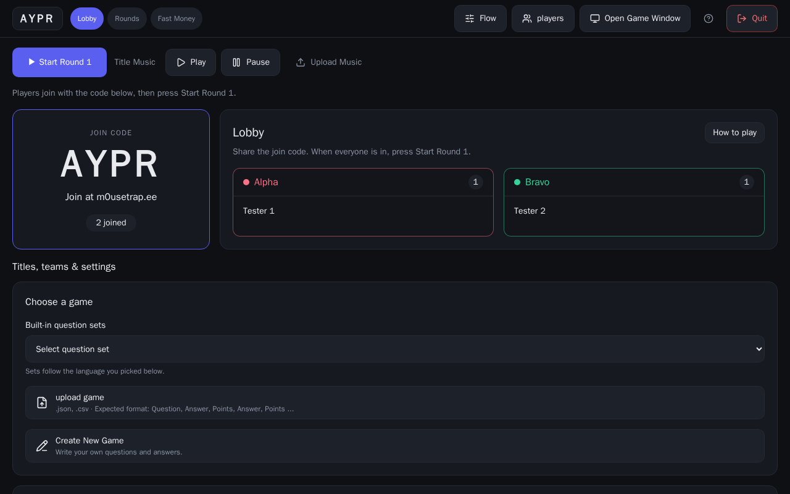<br><sub><b>Lobby</b>: players join with a 4-letter code</sub></td>
    <td>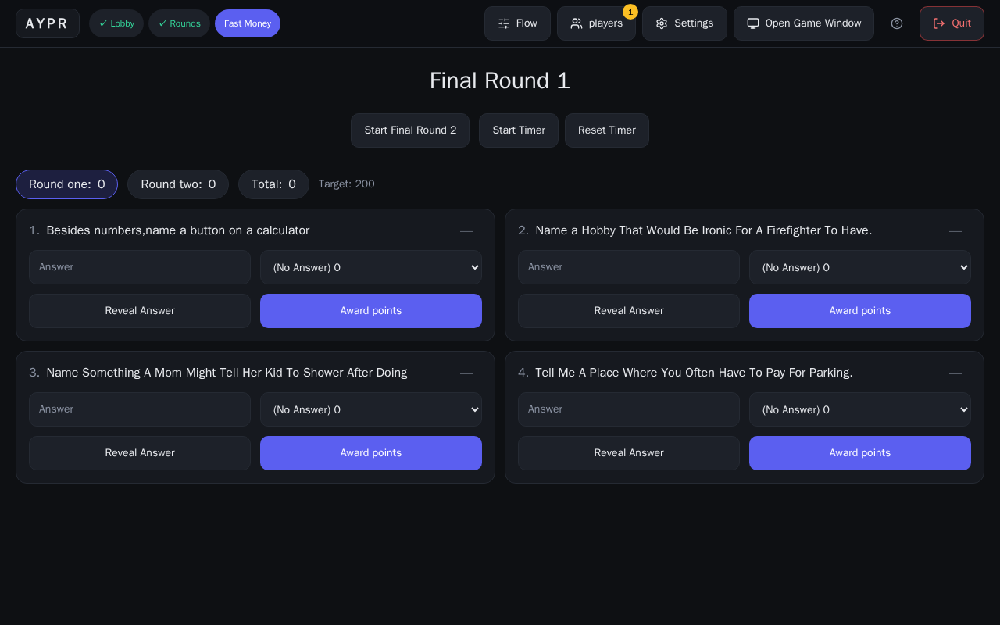<br><sub><b>Fast Money</b></sub></td>
  </tr>
  <tr>
    <td>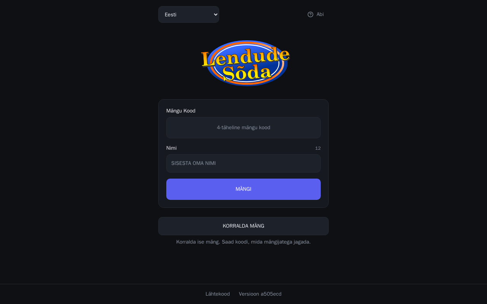<br><sub><b>Estonian UI</b>: <i>Lendude Sõda</i></sub></td>
    <td>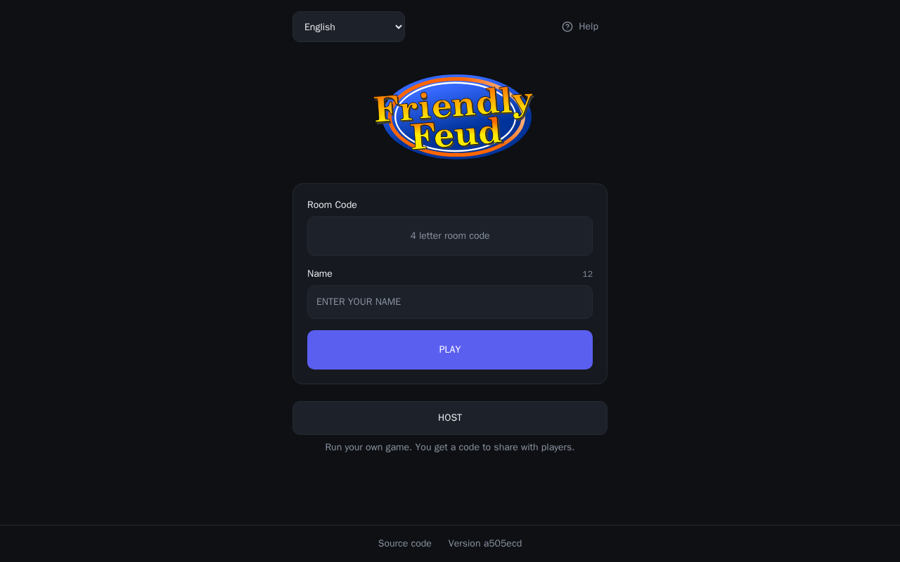<br><sub><b>English UI</b></sub></td>
  </tr>
</table>

<p align="center">
  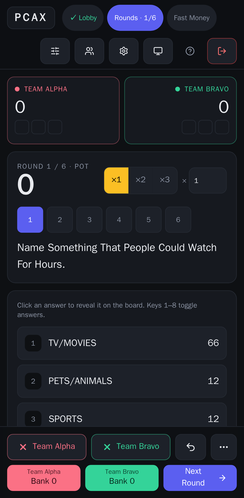
  &nbsp;&nbsp;&nbsp;
  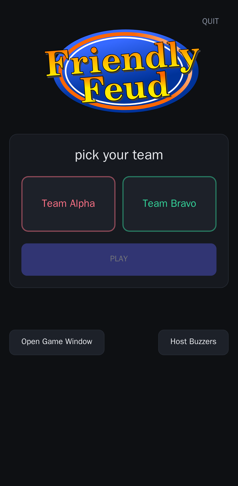
  <br><sub>Host console and player view on a phone (Pixel 7)</sub>
</p>

## 🧩 How it fits together

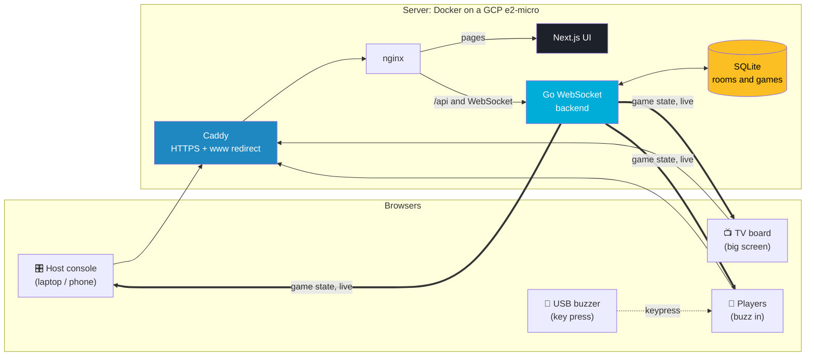

### A round, from the host's chair

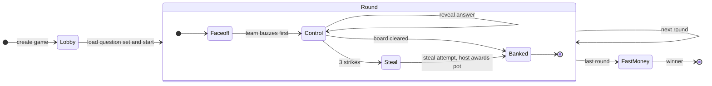

### 🔔 Buzzer flow

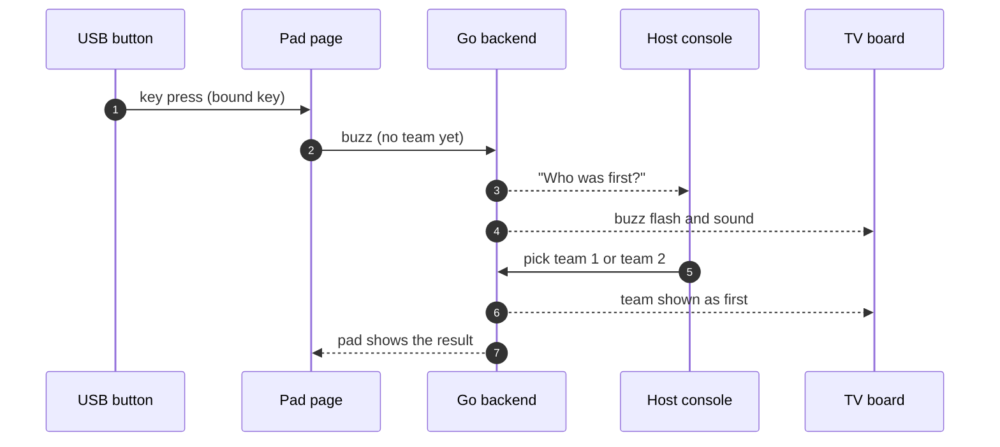

## 🇪🇪 Languages

English and Estonian are both fully translated: UI, tutorial and docs. The language switcher is on the home page
and in the host's settings, and changing it moves the whole room, including the list of question sets.
Estonian games live in [`Friendly-Feud/games/et/`](Friendly-Feud/games/et). Add your own as JSON or CSV
from the setup screen.

## 🚀 Quick start

You need Docker. Node 24 and Go are only needed if you want to work outside containers.

```bash
cd Friendly-Feud

# live-reload dev stack (http://127.0.0.1:8082)
make local-dev docker_registry=local

# the unit and e2e suites, in containers
scripts/node-run.sh npx vitest run
scripts/e2e-run.sh
```

### Deploy your own

```bash
cd Friendly-Feud
# build the all-in-one image; NEXT_PUBLIC_* values are baked in at build time
docker build -f Dockerfile.allinone \
  --build-arg NEXT_PUBLIC_TITLE_URL=your.domain \
  -t my-feud .
```

The full walk-through is in [`Friendly-Feud/deploy/README.md`](Friendly-Feud/deploy/README.md). It covers creating the
VM, DNS, Caddy for HTTPS, and `deploy/ship.sh` to push updates in one command.

| Setting | What it does |
|---|---|
| `ALLOWED_ORIGINS` | The exact `https://` origin allowed to open WebSockets. **Required.** |
| `ADMIN_CONSOLE_PASSWORD`, `ADMIN_SESSION_SECRET` | Protect the admin console. **Required.** |
| `MAX_ROOMS` | Cap on live rooms (50 in the shipped compose file). |
| `ROOM_CREATE_LIMIT_PER_HOUR` | Rooms one IP may create per hour. |

Rooms close after an hour of inactivity.

## 🗺️ Repo layout

```
.
├── Friendly-Feud/            the app
│   ├── src/                  Next.js pages and components (host console in components/Admin)
│   ├── backend/              Go WebSocket server
│   ├── games/{en,et}/        question sets
│   ├── i18n/, public/locales language setup and translations
│   ├── deploy/               Caddy, compose file and ship.sh for the VM
│   ├── e2e/                  Playwright tests, including the live-site audit
│   └── scripts/              container wrappers (node, go, e2e)
└── docs/screenshots/         images used in this README
```

## 🌿 Branches

| Branch | Contents |
|---|---|
| `redesign` | Everything in this README. It's the one to use. |
| `host-console-redesign` | Host console work only |
| `usb-buzzer` | USB buzzer work only |
| `hosting-deploy` | Deploy tooling and abuse limits only |
| `master` | Mirror of upstream, for reference |

## 🙏 Credits

- **[Josh Cold](https://github.com/joshzcold)** and the upstream contributors built
  [Friendly-Feud](https://github.com/joshzcold/Friendly-Feud): the game, the board, the websocket engine and the
  original question sets. This project wouldn't exist without it.
- Redesign, buzzer, Estonian localisation and hosting by **M0usetrap**.

Released under the [MIT License](Friendly-Feud/LICENSE), the same as upstream.
